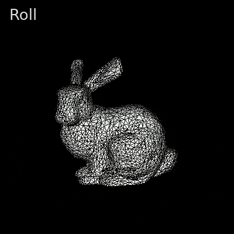
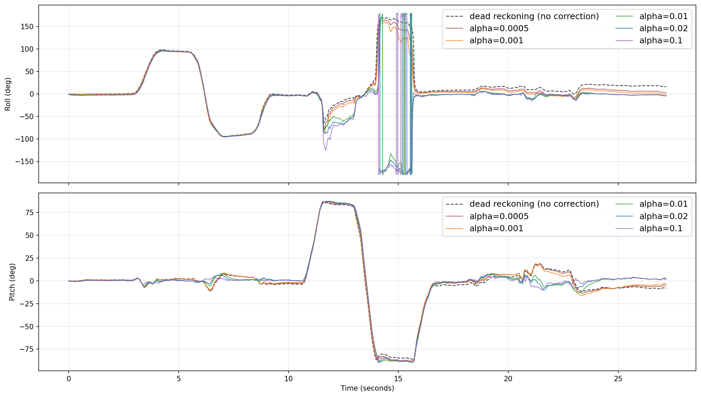
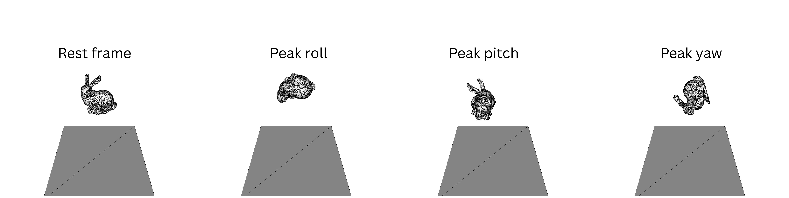

# VR Spatial Rotation System

*IMU sensor fusion and software rendering for VR orientation tracking*

This project estimates the orientation of a VR headset from raw inertial measurement unit (IMU) data and uses it to drive a software-rendered Stanford bunny. Gyroscope readings are integrated into quaternion orientation estimates, which are then corrected for drift by fusing accelerometer and magnetometer data through complementary filters. The renderer deliberately avoids a game engine, so every stage from matrix transformation to rasterisation is implemented directly in Python and the focus remains on the underlying tracking and rendering pipeline.

<p align="center">
  
</p>

<p align="center"><i>The central bunny rolling, pitching and yawing through roughly ±90° on each axis under the gyroscope and accelerometer filter, shown in real time.</i></p>

## Headline Results

| Measure | Dead reckoning | Complementary filter (α = 0.02) |
|---|---|---|
| Roll RMS error at rest | 18.6° | **2.8°** |
| Pitch RMS error at rest | 8.3° | **3.1°** |
| Estimated multiplications per sample | 38 | 140 |
| Measured runtime per sample | 45.7 µs | 72.4 µs |

RMS errors are measured against 0° during the final rest period (23 to 27.5 seconds), and runtimes are averaged over 10 runs of all 6,959 samples.

## Repository Contents

| File | Description |
|---|---|
| `render.py` | Full pipeline covering IMU loading, orientation filters, physics and rendering for both sequences |
| `report_analysis_metrics.py` | Reproduces every metric and figure cited in the report |
| `IMUData.csv` | 6,959 samples (about 27 seconds at 256 Hz) of gyroscope, accelerometer and magnetometer readings |
| `bunny.obj`, `floor.obj` | Stanford bunny mesh and the original floor mesh, which is unused in the final scene |
| `sequence1_gyro_accel.mp4`, `sequence2_full_fusion.mp4` | Rendered videos of both sequences |
| `xtzv61_report.pdf` | Report covering filter design, parameter investigations and performance analysis |
| `ORIGINAL UNMODIFIED engine.py` | The provided base renderer, kept for reference |
| `imgs/` | Figures and renders used in this README |

## Approach

### Orientation Estimation

- **Dead reckoning.** Gyroscope rates are converted to rad/s, integrated at each sample and accumulated as quaternions through the Hamilton product.
- **Tilt correction.** Accelerometer readings are smoothed with an exponential moving average (EMA), gated to magnitudes between 0.85g and 1.15g, rotated into the world frame and used to nudge the estimate towards true gravity by a fraction α of the tilt error.
- **Yaw correction.** The full fusion filter adds hard-iron and soft-iron magnetometer calibration, an EMA and a dual gate on angular rate and tilt before applying a small yaw correction towards the initial heading.

### Scene and Rendering

- **Software pipeline.** The mesh is normalised, transformed through model, view, perspective and viewport matrices, then rasterised using barycentric coordinates and a z-buffer.
- **Falling bunnies.** Smaller bunnies spawn at random intervals, fall under gravity with quadratic air drag and rebound off the central bunny through sphere-based collision with a coefficient of restitution.

## Findings



Accelerometer fusion substantially reduced drift, cutting the roll RMS error at rest from 18.6° to 2.8°. Higher gains corrected drift more aggressively but produced spikier traces, since each correction trusts an accelerometer signal that linear acceleration corrupts during motion. Consequently, α = 0.02 offered the most balanced trade-off. The large roll spikes between roughly 11 and 16 seconds are an artefact of the Euler-angle conversion near its singularity, so they do not reflect the filter's actual estimate.

Magnetometer correction, however, did not improve yaw on this dataset. The accelerometer-only filter already settled close to zero yaw, whilst higher magnetometer gains introduced a persistent offset. This may be attributable to correcting EMA-smoothed live readings towards a single noisy reference sample captured at t = 0.



Static renders at the rest frame and at peak roll, pitch and yaw confirm that each rotational component maps onto the expected axis.

## Key Learnings

- **Correction gain is a noise-drift trade-off.** Higher gains reduce drift but amplify short-term accelerometer noise, so the best value sits between the extremes.
- **Additional sensors do not guarantee better estimates.** The magnetometer degraded yaw because each correction introduced more error than the drift it removed, which highlights the importance of reference quality.
- **Euler angles are unreliable for analysis near singularities.** Quaternions kept the filter itself free of gimbal lock, whilst the Euler conversion used for plotting produced spurious spikes near ±90° pitch.
- **Fusion is cheap in absolute terms.** The complementary filter ran 1.59× slower than dead reckoning, yet both used under 0.1 ms per sample, which is well within a typical VR motion-to-photon budget.

## Limitations

Yaw remains the weakest axis, as the accelerometer cannot observe it and magnetometer correction proved unreliable here. Positional tracking would require double integration of the accelerometer, which accumulates error quadratically and is impractical without an external reference such as cameras. Sphere-based collision is also a coarse fit for the bunny's geometry, and axis-aligned bounding boxes or a bounding volume hierarchy would reduce false positives.

## Running the Project

The project was developed with Python 3.11. Install the dependencies and run the renderer with the following commands.

```bash
pip install numpy opencv-python pandas scipy matplotlib
python render.py
```

The two sequences play one after the other, and pressing any key closes the first window and starts the second. Setting `RECORD_VIDEO` to `True` in `HYPERPARAMS` writes both sequences to MP4 instead, although software rendering makes this slow. Running `python report_analysis_metrics.py` reproduces the reported metrics, with minor variation as the script is not seeded.

## Credits

The base renderer is Nicolas Rougier's Tiny 3D Renderer, as modified by George Koulieris. The filter design draws primarily on LaValle et al.'s Oculus Rift head-tracking work, LaValle's *Virtual Reality* textbook and Madgwick's orientation filter, with full references in `xtzv61_report.pdf`.
